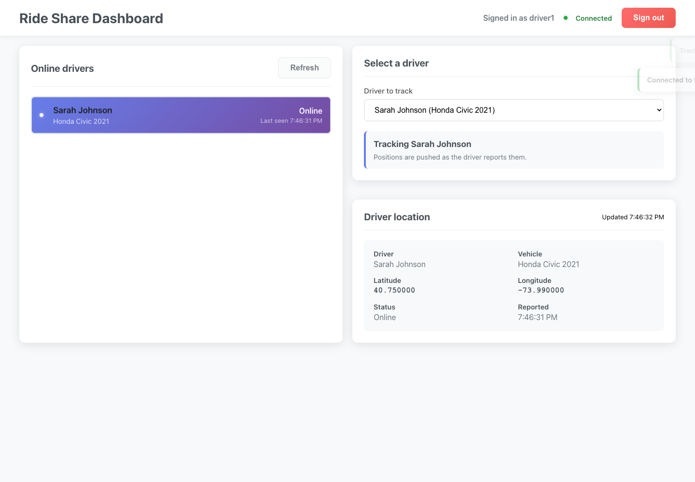

# Ride-share driver tracking

Live driver location tracking. Drivers sign in and send position updates over REST or a Socket.IO connection, and a dashboard subscribes to one driver at a time and gets their positions as they come in. There are no trips, fares or passengers here, only driver presence and coordinates. Built as a take-home exercise.

The repo has two parts: the Express + Socket.IO server in `src/`, and a small React client in `frontend/` with a monitoring dashboard and a driver simulator.



## Getting started

Node 20 or newer.

```bash
cp .env.example .env
npm install
npm run dev          # API and sockets on port 3001

cd frontend
npm install
npm start            # React app on port 3000
```

Open http://localhost:3000, choose "Driver app", sign in as `driver1` / `password1` and start sharing location. In another tab, sign in on the Dashboard with the same account and pick the driver from the list. Seeded accounts are `driver1` to `driver3` with passwords `password1` to `password3` (see `src/utils/credentials.js`).

The client uses `REACT_APP_API_URL`, defaulting to `http://localhost:3001`.

## How it works

- `POST /api/login` returns a JWT; `POST /api/logout` revokes it on the server so it can't be reused
- Positions come in through `POST /api/driver/update` or the `location_update` event on the `/driver/update` namespace
- The `/dashboard` namespace puts each subscriber in a `driver:<id>` room, so a position is only sent to clients watching that driver
- A driver counts as online while their last fix is newer than `DRIVER_STALE_AFTER_MS`; a periodic sweep tells subscribers when a driver goes quiet
- Other routes: `GET /api/profile`, `GET /api/driver/location`, `GET /api/driver/online`, `GET /api/driver/:driverId/location`, `GET /api/driver/stats`, `GET /health`

All state is held in memory in `src/models/driverStore.js`.

## Tests and tooling

```bash
npm test          # node:test, backend only
npm run lint
npm run format
```

The realtime tests start a real server and connect with `socket.io-client`. A sample curl session is in [docs/api-transcript.md](docs/api-transcript.md) and a captured test run in [docs/test-output.md](docs/test-output.md).

A `Dockerfile` and `docker-compose.yml` are included but haven't been built or run yet.

## Limitations

- Restarting the server loses all positions and tokens, and it can only run as a single instance.
- Credentials are plain text and the `/dashboard` socket has no auth.
- Simulated positions are random points in a New York bounding box, shown as coordinates (no map).
